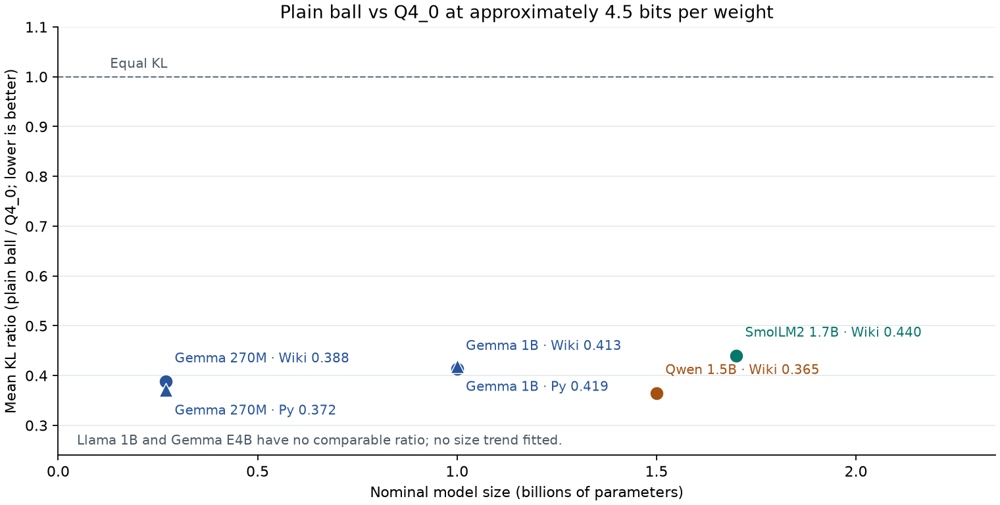

# How far does the Gemma 270M result transfer?

**Decision: finish Gemma 4B and fund a packed-kernel benchmark, not a fleet forecast.** In every available near-rate-matched plain-ball comparison against Q4_0, the ball lowers mean KL: ratios span **0.365–0.440** across Gemma 270M and 1B, Qwen2.5 1.5B and SmolLM2 1.7B. The Gemma plain-ball gains shrink modestly at 1B on both texts, but the cross-family series is not monotone and does not support extrapolation. Real b624 beats calibrated Q4_K_M at lower block bpw on both measured Gemmas; on Python, the b560 loss followed by the b624 win repeats. Historical models support the direction of the calibrated comparison at their own rates, not Gemma's stock rate or its matched-quality savings. This retrospective is **N0, sampled/fragile**, not a new method claim.

## Headline contrasts

Ratios are candidate mean KL / stock mean KL (lower is better). The calibrated ratio includes **candidate / baseline block bpw**; comparisons are not iso-bitrate. Calibration gap is real-text minus random-vocabulary ball KL, always at b560. Dashes mean no comparable measurement located, not zero. Wiki = wikitext-2 test; Py = Python source.

| Model (nominal size) | Text | Plain b560 / Q4_0 | Real matrix / Q4_K_M-imat (bpw) | Real − random ball KL | Sources |
|---|---|---:|---:|---:|---|
| Gemma 3 270M IT | Wiki | 0.388 | 0.399 (b624; 5.0180 / 5.4338) | −0.010941 | [G] |
| Gemma 3 270M IT | Py | 0.372 | 0.631 (b624; 5.0180 / 5.4338) | −0.003719 | [G] |
| Gemma 3 1B IT | Wiki | 0.413 | 0.620 (b624; 5.0081 / 5.4818) | −0.006918 | [I] |
| Gemma 3 1B IT | Py | 0.419 | 0.601 (b624; 5.0081 / 5.4818) | −0.000110 | [I] |
| Llama 3.2 1B Instruct | Wiki | — | 0.674 (b560; 4.5052 / 4.8023) | −0.004148 | [L] |
| Llama 3.2 1B Instruct | Py | — | 0.635 (b560; 4.5052 / 4.8023) | −0.002307 | [L] |
| Qwen2.5 1.5B Instruct | Wiki | 0.365 | 0.741 (b560; 4.5060 / 4.8120) | −0.001935 | [Q], [R], [M] |
| Qwen2.5 1.5B Instruct | Py | — | 0.790 (b560; 4.5060 / 4.8120) | −0.000798 | [P] |
| SmolLM2 1.7B Instruct | Wiki | 0.440 | 0.746 (b560; 4.5047 / 4.8223) | −0.003155 | [S], [R], [M] |
| SmolLM2 1.7B Instruct | Py | — | 0.711 (b560; 4.5047 / 4.8223) | −0.000979 | [P] |
| Gemma 4 E4B IT (7.5B total) | llama.cpp docs/code | — | — | — | [E], [B] |

The companion b560 comparison gives KL ratios **0.830 / 1.141** at 270M (4.5178 / 5.4338 bpw; [G]) and **1.158 / 1.176** at 1B (4.5080 / 5.4818 bpw; [I]), Wiki / Python. The Python b560 loss and b624 win repeat in point estimates; the 1B b560 Python loss is below the descriptive 2-SE screen, unlike its b624 win. On Wiki, b560 beats stock at 270M but not at 1B. **Llama 1B** has no Q4_0 in the cited run; its plain ball loses to uncalibrated Q4_K_M on both texts. Real calibration has lower observed KL than random in all ten cells, but the gaps vary and some are small compared with marginal SEs (notably Gemma 1B Python and [P]); there is no universal case to pay for real-text calibration. On Qwen Python, both real and random b560 lose to *plain* b560 in mean KL.

## Auditable measurements

Cells are **reported block bpw / mean KL / top-1 kept %**, not whole-file rates. Each row compares against its run's own F16 reference. Where multiple sources are needed: [Q]/[S] for Q4_0; [M] for real-matrix Q4_K_M (KL/top-1); [R] for four-decimal Q4_K_M rates and ball arms (including plain). The two Gemma rows per model use their [raw receipts](RESULTS_RECEIPTS.md). The older real ball weights use the historical calibration recipe, not necessarily Gemma's weighting strength or overhead.

| Model / text | Q4_0 | Q4_K_M | Q4_K_M-imat | Plain b560 | Real b560 | Random b560 | Real b624 | Sources |
|---|---|---|---|---|---|---|---|---|
| Gemma 270M Wiki | 4.5000 / 0.501528 / 70.137 | 5.4338 / 0.153572 / 83.049 | 5.4338 / 0.091622 / 86.755 | 4.4998 / 0.194755 / 80.088 | 4.5178 / 0.076017 / 87.922 | 4.5178 / 0.086958 / 87.480 | 5.0180 / 0.036582 / 91.588 | [G] |
| Gemma 270M Py | 4.5000 / 0.565080 / 77.647 | 5.4338 / 0.166596 / 87.899 | 5.4338 / 0.088345 / 91.765 | 4.4998 / 0.209988 / 85.658 | 4.5178 / 0.100806 / 90.868 | 4.5178 / 0.104525 / 90.532 | 5.0180 / 0.055786 / 92.885 | [G] |
| Gemma 1B Wiki | 4.5000 / 0.253345 / 78.775 | 5.4818 / 0.082847 / 87.441 | 5.4818 / 0.049941 / 90.343 | 4.4998 / 0.104723 / 86.000 | 4.5080 / 0.057824 / 89.961 | 4.5080 / 0.064742 / 89.137 | 5.0081 / 0.030960 / 92.775 | [I] |
| Gemma 1B Py | 4.5000 / 0.238356 / 85.042 | 5.4818 / 0.065954 / 92.941 | 5.4818 / 0.051476 / 93.613 | 4.4998 / 0.099914 / 91.989 | 4.5080 / 0.060526 / 93.501 | 4.5080 / 0.060636 / 92.605 | 5.0081 / 0.030943 / 94.902 | [I] |
| Llama 1B Wiki | — | 4.8023 / 0.043179 / 89.03 | 4.8023 / 0.035923 / 90.02 | 4.4998 / 0.047808 / 88.86 | 4.5052 / 0.024224 / 91.50 | 4.5052 / 0.028372 / 90.49 | — | [L] |
| Llama 1B Py | — | 4.8023 / 0.037139 / 92.54 | 4.8023 / 0.034137 / 92.19 | 4.4998 / 0.045635 / 91.37 | 4.5052 / 0.021682 / 93.96 | 4.5052 / 0.023989 / 93.88 | — | [L] |
| Qwen 1.5B Wiki | 4.500 / 0.062335 / 88.22 | 4.8120 / 0.033348 / 91.11 | 4.8120 / 0.028205 / 91.84 | 4.4998 / 0.022750 / 92.75 | 4.5060 / 0.020898 / 92.64 | 4.5060 / 0.022833 / 92.81 | — | [Q], [M], [R] |
| Qwen 1.5B Py | — | 4.8120 / 0.022319 / 94.52 | 4.8120 / 0.019446 / 94.84 | 4.4998 / 0.013971 / 95.37 | 4.5060 / 0.015366 / 95.48 | 4.5060 / 0.016164 / 95.40 | — | [P] |
| SmolLM2 1.7B Wiki | 4.500 / 0.127149 / 82.35 | 4.8223 / 0.083761 / 85.52 | 4.8223 / 0.037827 / 89.56 | 4.4998 / 0.055962 / 88.25 | 4.5047 / 0.028205 / 91.35 | 4.5047 / 0.031360 / 90.73 | — | [S], [M], [R] |
| SmolLM2 1.7B Py | — | 4.8223 / 0.052163 / 91.18 | 4.8223 / 0.023435 / 93.95 | 4.4998 / 0.036447 / 92.48 | 4.5047 / 0.016664 / 94.89 | 4.5047 / 0.017643 / 94.82 | — | [P] |

For Wiki, the earlier Qwen and SmolLM2 reports also contain Q4_0-imatrix (4.516 / 0.051859 / 88.54 and 4.516 / 0.086033 / 85.80, respectively; [M]). Random-matrix Q4_K_M is a separate stock control in [R], [P] and [L]; the headline ratio uses real-matrix stock only.

| Run / text | EBG128:b560s16 | HBG128:b560s16 | Unrotated VE8Z32:16 | Sources |
|---|---|---|---|---|
| Gemma 270M Wiki | 4.4999 / 0.178904 / 81.608 | 4.4999 / 0.174683 / 81.588 | 4.5000 / 0.394135 / 73.971 | [G] |
| Gemma 270M Py | 4.4999 / 0.186328 / 88.347 | 4.4999 / 0.167353 / 88.011 | 4.5000 / 0.377994 / 82.297 | [G] |
| Gemma 1B Wiki | 4.4999 / 0.098952 / 85.794 | 4.4999 / 0.096326 / 86.373 | 4.5000 / 0.190113 / 81.059 | [I] |
| Gemma 1B Py | 4.4999 / 0.084463 / 92.213 | 4.4999 / 0.093926 / 90.980 | 4.5000 / 0.176879 / 87.899 | [I] |
| Qwen 1.5B Wiki | 4.500 / 0.019549 / 93.08 | — | 4.500 / 0.043414 / 89.55 | [Q] |
| SmolLM2 1.7B Wiki | 4.500 / 0.060861 / 87.50 | — | 4.500 / 0.124728 / 82.75 | [S] |

No matching EBG/HBG/VE8Z rows were located for Llama or the older Python extension. **E4B is context only:** the November 15 Gemma 4 E4B record scores on mixed llama.cpp documentation/code against **Q8_0** saved outputs (its F16-stored copy matches that same reference, not an independent F16 model). It modifies block matrices and reports Q4_0 **4.500 / 0.1173 / 89.40**, Q4_K_M **4.803 / 0.0689 / 91.79**, its distinct E8 arm VE832:16 **4.500 / 0.0747 / 91.57**, and D+E8:32 **5.009 / 0.2748 / 85.99** ([E]). The November 17 joined arm **4.484 / 0.0629 / 92.02** also uses that Q8 reference ([B]); it is not a ZBG arm. Neither supplies a matching plain ball, matrix ball or imatrix stock contrast. [W] studies rounding error, not model-output KL/top-1. None fills the 7B-class F16 validation gap.

Different model families, texts or text windows, runner builds, rate overheads, and calibration recipes limit comparisons. These are single reported runs per cell, not multiple calibration seeds or an uncertainty estimate across models. Historical observations support the **direction** of the opportunity where measured, not its production magnitude: retain 25/50/100% as illustrative positive-transfer sensitivities and explicitly allow **0% transfer (zero modeled savings)**; runtime regressions can still make deployment net negative.

## Next experiments, in impact order

1. **Finish the in-flight Gemma 4B sweep and verify the output receipts.** On both texts compare actual stock rates, plain b560/Q4_0, real b496/b560/b624/Q4_K_M-imat, and real/random b560. Check whether 4B retains the calibrated advantage when the stock rate changes.
2. **Measure iso-KL packing and benchmark decode against stock.** Start in parallel on 1B: encode an intermediate rate near 4.66 block bpw, measure fidelity, then compare full artifact bytes, resident memory, throughput and latency at batch 1 and a realistic batch.
3. **Replicate a compact matched F16 sweep on a 7B-class target.** Run Q4_0, calibrated Q4_K_M and enough nearby ball rates to bracket KL parity. Choose a target without the reported 1B stock fallback to separate the apparent deployment gain from that particular baseline's rate. The Q8 E4B record cannot answer this.
4. **Run paired downstream evals on baseline and matched candidate.** Prioritize held-out language and code tasks, plus a narrow regression panel; KL, top-1 and PPL are not deployment acceptance criteria.
5. **Repeat real/random calibration across seeds and a held-out domain.** Keep the same arm/rate and quantify paired variation. Promote random calibration only if it preserves quality under this check.
6. **Close targeted historical control gaps.** Add matched Q4_0 to Llama/Python and only rerun Hadamard/E8 controls where they would change the deployment choice. Do not infer missing ratios.
7. **Expand families, hardware, or method variants only after the above.** Then decide whether the result warrants a reproducibility note, a funded serving pilot, or any external announcement.

## Pinned source records

[G]: https://github.com/Moissanite-Labs/siliquant/blob/964b5f4ac988cac176ee4a5825ad1575430a56ab/experiments/model-output-gemma-ball-2026-11-23/out/gemma-3-270m-it/results.jsonl
[I]: https://github.com/Moissanite-Labs/siliquant/blob/964b5f4ac988cac176ee4a5825ad1575430a56ab/experiments/model-output-gemma-ball-2026-11-23/out/gemma-3-1b-it/results.jsonl
[L]: https://github.com/Moissanite-Labs/siliquant/blob/15383d5b0c44da1ed1271bd46f54b2b8934d6ba0/experiments/third-model-llama32-2026-11-18/results.out
[Q]: https://github.com/Moissanite-Labs/siliquant/blob/b522426596e9a874f22a84f2427e80238caacc6c/experiments/model-output-qwen25-2026-11-17/results.out
[S]: https://github.com/Moissanite-Labs/siliquant/blob/63dfd5254271d712dabe0c88346ea01fc14a9b31/experiments/model-output-smollm2-2026-11-17/results.out
[M]: https://github.com/Moissanite-Labs/siliquant/blob/10e2677aa7b368cb73fbb79f9af954227c894478/experiments/imatrix-baseline-2026-11-17/results.out
[R]: https://github.com/Moissanite-Labs/siliquant/blob/330979fbf400f42fd39be083d8d5cc04cea74ead/experiments/imatrix-gain-parts-2026-11-18/results.out
[P]: https://github.com/Moissanite-Labs/siliquant/blob/36c09dc6d183b7d77173138df62585d52e9b8579/experiments/second-text-python-2026-11-18/results.out
[E]: https://github.com/Moissanite-Labs/siliquant/blob/79613683bd4770a10abea09448dafe32e6540d9d/experiments/model-output-gemma-e4b-2026-11-15/results.out
[B]: https://github.com/Moissanite-Labs/siliquant/blob/abcf1f6f705b38c278ae88e28908c561ae85c0c6/experiments/output-budget-gemma-e4b-2026-11-17/README.md
[W]: https://github.com/Moissanite-Labs/siliquant/blob/1c3d4c9efc749ea3d947dcc7a385224b862b982d/experiments/lattice-vs-scalar-rounding-2026-11-15/results.out
