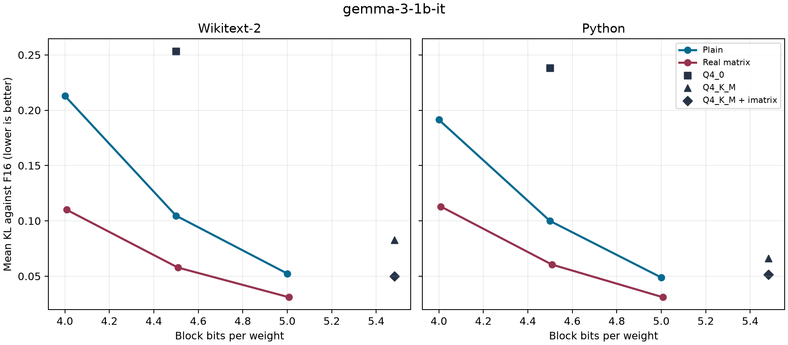

# Gemma 3 1B — Impact brief

## Executive summary

- **Fund the larger-model and packed-serving checks, not a launch.** At 4.4998 vs 4.5000 block bpw, plain ball cuts Q4_0 mean KL by **58.7% / 58.1%** and adds **7.225 / 6.947 pp** top-1 keep (wikitext / Python).
- At 5.0081 vs 5.4818 bpw, real-matrix b624 cuts calibrated Q4_K_M KL by **38.0% / 39.9%** and adds **2.432 / 1.289 pp** top-1 keep. The 4.5080-bpw b560 variant saves 0.9738 bpw but has **15.8% / 17.6% higher KL**.
- Interpolated KL parity with that stock baseline saves **0.8271 / 0.8208 block bpw**, or **15.09% / 14.97% of quantized block storage**. This is not whole-model or measured serving savings.
- Real-text and random b560 are nearly tied on Python; do not pay for curated data or replace it universally on this evidence. Confirm quality, task metrics and calibration stability.
- [Raw receipts](../RESULTS_RECEIPTS.md) and [historical context](../CROSS_MODEL_TRANSFER.md) strengthen the result at these model sizes. Two texts, one reported calibration draw, and GGUF block rates do not establish production transfer.

## Measured comparisons and practical size

Rates are block bpw, not file bytes. The [complete impact tables](IMPACT_TABLES.md)
show actual rates, KL ratios, top-1 deltas, PPL versus F16, and matched-KL
curves against Q4_0, Q4_K_M, and Q4_K_M-imatrix. The uncalibrated plain
and Hadamard b560 controls are the closest rate matches to Q4_0; real
and random weights add 0.0080 bpw. The reported shape-dependent
`Q4_K_M` fallback (1152 columns; the runner operator reports Q5_0/Q8_0 use) matters to
the business comparison: both raw stock K rows are **5.4818** bpw in both
rate fields, whereas the b560 ball variants here are 4.4998–4.5080.
The JSONL verifies those rates, not the tensor shapes or per-tensor type
assignments. Do not assume the same stock rate on another architecture.

| Arm vs Q4_0 | Block bpw | Mean KL Wiki / Python | KL reduction Wiki / Python |
|---|---:|---:|---:|
| Plain b560 | 4.4998 | 0.104723 / 0.099914 | 58.7% / 58.1% |
| Hadamard b560 | 4.4999 | 0.096326 / 0.093926 | 62.0% / 60.6% |
| Real matrix b560 | 4.5080 | 0.057824 / 0.060526 | 77.2% / 74.6% |
| Random matrix b560 | 4.5080 | 0.064742 / 0.060636 | 74.4% / 74.6% |

The calibrated stock mean KL is 0.049941 / 0.051476. The real b624
improvement over it clears the descriptive 2-SE screen on both texts
(8.50 / 3.76 quadrature SE). Plain b624 is numerically better on Python
(0.048834 vs 0.051476), but only **0.44 SE**; this is not a demonstrated
fidelity win. Real b560's higher KL clears the screen on Wiki but not on
Python, where the b560-to-b624 point-estimate reversal repeats 270M.
The real-minus-random KL gaps are −0.006918 / −0.000110 (about 2.08 /
0.013 quadrature SE). These screens use marginal, not paired SEs.
The raw runner supplies marginal top-1 and PPL errors; this report does
not use them to conclude a difference. Hadamard Wiki PPL falls from
**27.164816 to 26.213897** (−3.50%) despite mean KL 0.096326;
Hadamard Python PPL falls from 6.467454 to 6.342953 as well. Do not quote
PPL alone as evidence of fidelity or downstream improvement.

## Discovery and actions

| Candidate | Novelty / evidence | Recommendation |
|---|---|---|
| Real b624 beats calibrated stock at fewer bits on both Gemma sizes | N1 candidate, sampled/fragile: useful benchmark evidence, not a new quantizer | Fund measured iso-KL packing, 4B and 7B-class replication, and a paired serving benchmark. If reproduced, publish artifacts; no performance launch yet. |
| Plain/Hadamard win against Q4_0 near 4.5 bpw | N0 as a method claim, sampled/fragile as a new Gemma control | Publish as a control after comparable stronger stock baselines and downstream tasks; no separate patent or funding claim. |
| Random calibration approaches real on Python | N0, sampled/fragile, consistent with prior mixed calibration evidence | Prioritize multi-seed held-out evaluation, not an announcement that calibration data is unnecessary. |

The [270M prior-art and disclosure review](../gemma-3-270m-it/README.md#prior-art-and-disclosure)
covers deployed llama.cpp baselines, GPTQ/AWQ, recent lattice/vector
quantization, and rotation and calibration research. The public repository
and prior work make a broad novelty claim unwarranted; consult counsel only
if a specific new implementation claim emerges. This is not legal advice.

## Hyperscaler sensitivity, not an operator-specific forecast

The smaller matched-KL estimate, **0.8208 block bpw**, is the anchor.
Retaining the [same H200 assumptions](../gemma-3-270m-it/README.md#hyperscaler-decision-model),
the low/mid/high rows model **0.46% / 2.69% / 9.40%** less resident
memory, **0.35% / 2.06% / 8.11%** fewer fleet-equivalent accelerators,
and **$6.1K / $0.54M / $35.5M** annual gross opportunity at fixed
demand. These are conditional sensitivities, with zero modeled savings
at zero transfer and possible negative net benefit when serving overhead
is counted. The 1B data do not justify narrowing the transfer inputs:
the stock rate is model-specific, the KL match is interpolated, and
packed memory, dequantization and latency have not been measured.

## Receipts and replay

[Pinned files and input identifiers](../RESULTS_RECEIPTS.md). All
34 headline cells parsed; no bridge cells, additional seeds, paired
position-level errors, downstream scores, or whole-file byte accounting
are supplied. The raw runner's F16 PPL fields supply the baselines below.



From the experiment directory after fetching the pinned commit as described
in the [results receipts](../RESULTS_RECEIPTS.md):

```sh
git show 964b5f4:experiments/model-output-gemma-ball-2026-11-23/out/gemma-3-1b-it/results.jsonl > 1b-results.jsonl
python3 -I -B analyze.py 1b-results.jsonl --model gemma-3-1b-it \
  --f16-wikitext 27.164816 --f16-python 6.467454
python3 -B plot_impact.py 1b-results.jsonl --model gemma-3-1b-it \
  --out reports/impact/gemma-3-1b-it/KL_VS_BPW.png
```
