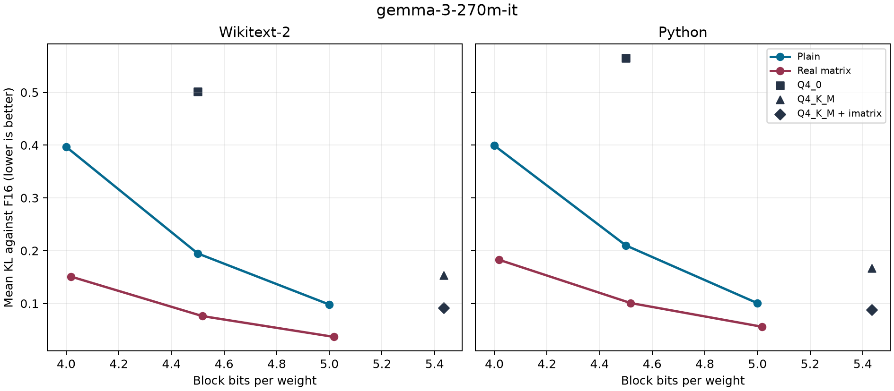

# Gemma 3 270M — Impact brief

## Executive summary

**Fund a replication and kernel benchmark, not a rollout or a breakthrough
announcement.** On the supplied 270M table, the 4.5178-bpw real-text-matrix
ball has **85% / 82% lower mean KL** and **+17.8 / +13.2 pp top-1 keep**
versus 4.5000-bpw Q4_0 (wikitext / Python). That is nearly rate-matched, not
bit-identical. With plain ball at 4.4998 bpw, the strictly closer match is
**61% / 63% lower KL**. The stronger imatrix Q4_K_M baseline runs at
5.4338 bpw: the 5.0180-bpw matrix ball has lower KL on both texts; matching
its KL by interpolation suggests **0.78–1.02 bpw less**, or **14.3–18.8%
of quantized block storage**. Neither result establishes whole-model size
or downstream quality.

The useful new result is a **local Gemma rate–fidelity data point**, not a
new family of quantizers. Under explicitly hypothetical H200-class
deployments the block improvement maps to **0.43–8.96%** less resident
memory and **0.33–7.74%** fewer fleet-equivalent accelerators at fixed
demand (roughly **$5.8K / $0.52M / $33.9M** annual gross in the three different
scenarios). These are what-if sensitivities, not estimates for a specific serving operator; savings
can be zero or negative at production latency if the packed kernel loses
bandwidth efficiency. The evidence is a rounded 270M transcription, two
texts, and a single stated calibration seed; verify the raw receipts and
repeat at 1B and 7B+ before any external numerical claim.

The [cross-model read](../CROSS_MODEL_TRANSFER.md) finds plain-ball wins
against Q4_0 near 4.5 bpw in all available comparisons on Gemma 270M, Qwen
1.5B, and SmolLM2 1.7B (KL ratios 0.365–0.440), but no established size
trend. Llama 1B supports the calibrated comparison, not the Q4_0
comparison; historical Gemma E4B is Q8-reference context only. Prioritize
matched F16 runs at 1B and 7B-class scale and packed decode before modeling
any production gain as expected.

## What matters and what to do

Numbers in [the complete impact tables](IMPACT_TABLES.md) are per text.
They rank stock comparisons by absolute relative KL effect, show actual
block bpw, KL ratio/gain, top-1 percentage points, and PPL change versus F16.
The reported KL-SE screen uses marginal quadrature, not paired inference
or family-wise significance. Top-1 and PPL have no supplied uncertainty.

| Priority / finding | Effect and evidence | Novelty and recommendation |
|---|---|---|
| 1. Match stronger-stock fidelity using fewer block bits | At 5.0180 vs 5.4338 bpw, matrix ball KL is 0.399× / 0.631× imatrix Q4_K_M, +4.833 / +1.120 pp keep. The gains are 26.95 / 4.62 quadrature SE. The match is a linear interpolation between measured points, not a measured packed result. Plain ball never reaches the imatrix target within its measured range. | **N1 candidate, sampled/fragile:** locally useful Gemma frontier extension, not a new PTQ method. Fund matching-rate packed artifacts, replicated 1B and 7B+ plus primary Gemma, and serving benchmarks. If reproduced, publish benchmark artifacts and submit a systems/ML workshop or preprint; no patent claim on this result alone. |
| 2. Large gain versus stock Q4_0 at nominal 4.5 bpw | Matrix gains 53.42 / 15.14 quadrature SE; PPL is +9.64% / +4.30% versus F16, compared with Q4_0's +38.09% / +42.44%. Even the closest-rate plain match is substantially lower in KL. Q4_0 is the weaker comparator; include Q4_K_M-imatrix and modern deployable alternatives in any outward benchmark. | **N1 candidate, sampled/fragile:** a local control extension of existing in-repo results. Publish as a benchmark control after raw-data verification; do not announce it as the state-of-the-art improvement or seek separate patent funding. |
| 3. Calibration without a real-text corpus | At the same 4.5178 bpw, real text gains 0.010941 / 0.003719 KL and +0.442 / +0.336 pp over the random-vocabulary matrix. Random still gains 0.414570 / 0.460555 KL against Q4_0. Real and random also beat the two zero-calibration comparators on KL, but those are different arm families, not controlled calibration-only comparisons. | **N0 method, sampled/fragile:** the repository already ran random-vocabulary imatrix on Llama. A possibly useful packaging option; repeat over calibration seeds, data access regimes and downstream tasks before advertising “no corpus needed”; no patent or separate funding priority. |
| 4. Near-ties and rotation comparisons | The 5.0000-bpw plain ball versus 5.4338-bpw imatrix Q4_K_M on Python differs by only 1.46 quadrature SE, below the descriptive screen. Zero-calibration HBG and VE8Z differences are listed in the tables; they are not claims about mechanism or generic rotation benefits. | **N0, sampled/fragile:** don't promote the near-tie or submit an IP claim; retain as benchmark controls. |

### Prior art and disclosure

Reviewed method sections in [GPTQ](https://arxiv.org/html/2210.17323)
(approximate second-order PTQ) and [AWQ](https://arxiv.org/html/2306.00978)
(activation-aware channel scaling); [QuIP#](https://arxiv.org/html/2402.04396v3)
(randomized Hadamard and E8), [QTIP](https://arxiv.org/html/2406.11235v2)
(trellis VQ), [AQLM](https://arxiv.org/html/2401.06118v3) (additive VQ), and
[NestQuant](https://arxiv.org/html/2502.09720v2) (nested lattices and measured
rate curves); [QuaRot](https://arxiv.org/html/2404.00456v2) and
[SpinQuant](https://arxiv.org/html/2405.16406v4) (fixed/random or learned
rotations); [EasyQuant](https://arxiv.org/html/2403.02775) (data-free PTQ)
and [self-calibration](https://aclanthology.org/2025.naacl-long.509.pdf)
(model-generated synthetic samples). [llama.cpp imatrix](https://github.com/ggml-org/llama.cpp/blob/master/tools/imatrix/README.md),
[K-quants](https://github.com/ggml-org/llama.cpp/pull/1684) and
[E8/i-quants discussion](https://github.com/ggml-org/llama.cpp/pull/4773)
provide direct controls, not claims of novelty. Siliquant's
[Llama study](../../../../third-model-llama32-2026-11-18/README.md),
[Python study](../../../../second-text-python-2026-11-18/README.md), and
[Gemma preregistration PR #47](https://github.com/Moissanite-Labs/siliquant/pull/47)
show prior internal work and the open Gemma experiment. The N1 candidates
are local observations on this configuration only; **nothing here earns
N2 or establishes patent novelty or freedom to operate**.

GitHub reports [siliquant](https://github.com/Moissanite-Labs/siliquant)
is public. A draft PR, issue, commit or note can be a public disclosure;
audit existing disclosure dates and consult counsel before further release
if anyone identifies a genuinely new implementation claim. The
[USPTO describes a limited U.S. inventor-disclosure exception](https://www.uspto.gov/web/offices/pac/mpep/s2153.html);
do not assume it applies or preserves rights in other jurisdictions.
This is a disclosure flag, not legal advice.

## Hyperscaler decision model

The [scenario table](IMPACT_TABLES.md#illustrative-deployment-scenarios)
anchors on the smaller measured-text match (0.7776 block bpw); 7B / 27B /
70B parameter counts, 70% / 85% / 95% quantized coverage, and 25% / 50% /
100% transfer are **scenario inputs**, not observations from any serving operator. Historical
comparisons do not constrain those percentages; at 0% transfer the
model gives zero savings, and real runtime regressions could make net
savings negative. For each scenario, weight bytes are parameters ×
[covered fraction × effective bpw
+ uncovered fraction × 16] ÷ 8. Resident bytes add 20 GB of assumed KV and
workspace, and batch-one traffic adds a fixed 20% of baseline weight bytes.
[NVIDIA H200](https://www.nvidia.com/en-us/data-center/h200/) specifies
141 GB and 4.8 TB/s; bandwidth divided by bytes per decode step gives the
roofline (as a weight-only PTQ motivation, see [QTIP](https://arxiv.org/html/2406.11235v2)).
All scenarios already fit this specified HBM capacity; no claim of a
one-device fit threshold is made.

Ideal eligible capacity scales with baseline/new roofline. Multiply the
reduction by assumed eligible serving shares (25% / 50% / 75%), baseline
accelerator equivalents (100 / 1,000 / 10,000), assumed costs ($2 / $3 /
$5 per accelerator-hour), and 8,760 annual hours. No fleet or cloud price
figures are attributed to any specific operator. These are gross cost opportunities under
fixed demand, not profit, capex, or achievable throughput. The quality
improvement at near-equal bitrate is a separate benefit and gets **no dollar
credit** without evidence that it changes downstream task success or
required capacity. Real kernels may be limited by unpacking, attention,
prefill, batching, traffic, utilization, or latency SLOs. Compare against
deployed kernels on the target hardware at same SLOs and actual packed
bytes; ask for a small replication/benchmark budget, not fleet funding.

## Receipts and scope

[The runner operator's forwarded transcription](RUNNER_TRANSCRIPTION.md) contains
the 34 headline rows and the claimed SHA-256 strings. No raw JSONL/out was
located on fetched origin branch heads; the script binds only the local
transcription checksum. The missing bridge and primary E4B model do not
enter the estimates. The Python text/ref cache, imatrix identity, scored
positions, auxiliary uncertainties and non-block bytes cannot be verified
from the message. See the [runner schema](../../../README.md#runner-contract).
The figures establish neither downstream quality nor generalization to
other model sizes, samples, random seeds or serving stacks.



Reproduce from the experiment directory:

```sh
D=reports/impact/gemma-3-270m-it
python3 -I -B analyze.py "$D/RUNNER_TRANSCRIPTION.md" --model gemma-3-270m-it \
  --transcribed-table --f16-wikitext 50.594102 --f16-python 8.38385
python3 -B plot_impact.py "$D/RUNNER_TRANSCRIPTION.md" --model gemma-3-270m-it \
  --transcribed-table --out "$D/KL_VS_BPW.png"
```
