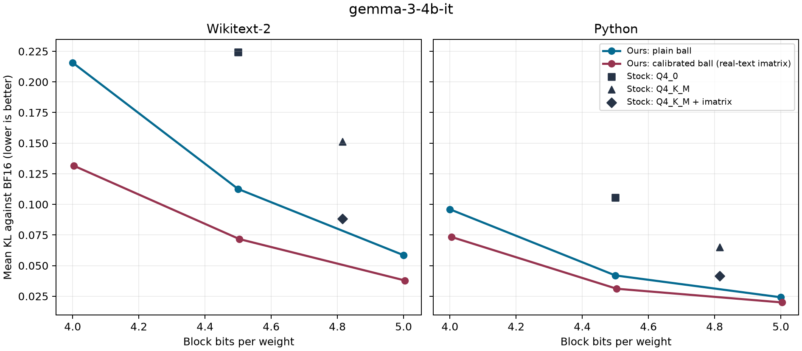

# Gemma 3 4B — Impact brief

## Executive summary

- **Fund an iso-KL packing and decode benchmark, not a rollout.** At **4.5040 vs 4.8151 block bpw**, real-text b560 lowers calibrated Q4_K_M mean KL by **18.9% / 25.4%** on wikitext / Python, with **+0.578 / +0.728 pp** top-1 keep. Both KL gains clear the descriptive 2-SE screen. The smaller Gemmas' b560-to-b624 Python reversal does not recur.
- Interpolated KL parity saves **0.4507 / 0.4361 block bpw**, or **9.36% / 9.06% of quantized block storage**. That is a smaller opportunity than at 1B, but it survives at the lower stock rate. Neither matched-rate point has been measured.
- Near 4.5 bpw, plain ball cuts Q4_0 KL by **49.8% / 60.3%**; real-text b560 cuts it by **68.1% / 70.5%**. Random calibration is numerically ahead of calibrated stock, but below the 2-SE screen on both texts.
- [Receipts](../RESULTS_RECEIPTS.md) verify both output blobs. The comparison uses reported **BF16** reference outputs, unlike the 270M and 1B F16 comparisons. The two texts do not establish cross-domain or production transfer.

## Measured comparisons and practical size

Rates below are block bpw, not file bytes. `Q4_K_M` and its calibrated
variant both report 4.8151 bpw in both rate fields on both texts, versus
5.4338 at 270M and 5.4818 at 1B. The runner reported no stock-format
fallbacks at 4B. The rows confirm the stock rates, not the fallback count
or per-tensor type assignments. The advantage at 4B therefore does not
depend on using the higher stock rates observed at the smaller sizes.

| Arm | Block bpw | Mean KL Wiki / Python | Compared with stock |
|---|---:|---:|---|
| Q4_0 | 4.5000 | 0.224386 / 0.105597 | Near-rate baseline |
| Plain b560 | 4.4998 | 0.112601 / 0.041972 | 49.8% / 60.3% lower than Q4_0 |
| Real b560 | 4.5040 | 0.071645 / 0.031101 | 68.1% / 70.5% lower than Q4_0 |
| Calibrated Q4_K_M | 4.8151 | 0.088353 / 0.041692 | Stronger stock target |
| Random b560 | 4.5040 | 0.080353 / 0.041052 | 9.1% / 1.5% lower than calibrated stock; 1.75 / 0.12 SE |
| Real b624 | 5.0042 | 0.037855 / 0.019908 | 57.2% / 52.2% lower than calibrated stock, **at 0.1891 more bpw** |
| Uncalibrated Q4_K_M | 4.8151 | 0.151295 / 0.065083 | Uncalibrated stock target |
| Real b496 | 4.0042 | 0.131462 / 0.073431 | 13.1% lower on Wiki, 12.8% higher on Python vs uncalibrated stock |

At 0.3111 fewer bpw, real b560 beats calibrated stock by **3.79 / 2.31
quadrature SE** with top-1 **90.853 / 95.294%** vs **90.275 / 94.566%**.
Real minus random b560 KL is **−0.008708 / −0.009951** (gain of 2.01 / 1.86
SE), so the random variant's near match to stock on Python does not prove
equivalence or justify removing calibration. Real b496 saves 0.8109 bpw
against uncalibrated stock; its Wiki gain is 2.90 SE, while the Python
loss is 0.82 SE. EBG b560 has lower KL than HBG b560 at the same rate
(0.094284 vs 0.100675 and 0.039951 vs 0.041296), but neither gain clears
2 SE (1.27 / 0.22). Adding K10 to real b560 does not improve KL
(0.071663 / 0.031448), at 0.0031 extra bpw. Marginal SEs are not paired
significance, and these comparisons do not screen top-1 or PPL deltas.

The Wiki `ZB128@R:16` PPL is **15.270076** vs **15.325197** reported
BF16 PPL despite mean KL **0.204709**. Lower PPL alone does not establish
fidelity or downstream improvement.

## Matched quality and serving sensitivity

The [impact tables](IMPACT_TABLES.md) interpolate between the observed real
b496 and b560 points to match the calibrated stock KL. The result is
**4.3644 / 4.3790** block bpw, not a measured encode or downstream match.
The 4B result supports transfer in **direction**, not the roughly
15% block savings from 1B. Use the smaller 4B estimate, **0.4361 block
bpw**, as the conservative anchor among these two 4B texts, not a floor
for other models.

Under the [same H200 scenario assumptions](../gemma-3-270m-it/README.md#hyperscaler-decision-model),
25/50/100% transfer models **0.25% / 1.49% / 5.41%** less resident memory,
**0.19% / 1.19% / 4.82%** fewer fleet-equivalent accelerators, and
**$3.4K / $0.31M / $21.1M** annual gross opportunity at fixed demand for
a hypothetical large-scale serving operator. These are sensitivities,
not forecasts: 0% transfer gives zero modeled savings, and an unfavorable
kernel can make net impact negative. Do not narrow the transfer factors
without measured packed bytes, memory, latency and throughput.

## Discovery and actions

| Candidate | Novelty / evidence | Recommendation |
|---|---|---|
| Real b560 beats calibrated stock on both texts at a lower stock rate than in the smaller runs | N1 candidate for local benchmark evidence, sampled/fragile; not a new quantizer | Fund a packed ~4.38-bpw candidate and a matched-stock decode benchmark now. Publish reproducible benchmark artifacts once quality, actual bytes and downstream/serving results are available. |
| Plain ball beats Q4_0 near 4.5 bpw; EBG is numerically ahead of HBG here | N0 method claim, sampled/fragile comparison | Report as controls; do not announce an EBG win without replication and uncertainty support. |
| Random calibration comes close to calibrated stock below its rate | N0, sampled/fragile, not equivalence | Repeat across seeds and held-out domains before replacing real-text calibration. |

No rollout announcement or broad patent claim is warranted. The
[prior-art and disclosure review](../gemma-3-270m-it/README.md#prior-art-and-disclosure)
remains applicable; consult counsel only for a specific new implementation
claim. The [transfer report](../CROSS_MODEL_TRANSFER.md) ranks next checks,
including the pending E4B bridge, which is not evidence for these claims.

## Receipts and replay

All 34 rows passed strict parsing; reported model/text identifiers and all
printed cells reconcile with the pinned results. Embedded hashes do not
verify independent GGUF/text bytes, reference precision, or calibration
inputs. No bridge rows, additional seeds, paired position-level records,
downstream scores, or whole-file accounting are supplied.



From the experiment directory, extract the 4B JSONL with the
[results receipts recipe](../RESULTS_RECEIPTS.md), then run:

```sh
python3 -I -B analyze.py 4b-results.jsonl --model gemma-3-4b-it --reference BF16 \
  --reference-wikitext 15.325197 --reference-python 4.991511
python3 -B plot_impact.py 4b-results.jsonl --model gemma-3-4b-it --reference BF16 \
  --out reports/impact/gemma-3-4b-it/KL_VS_BPW.png
```
